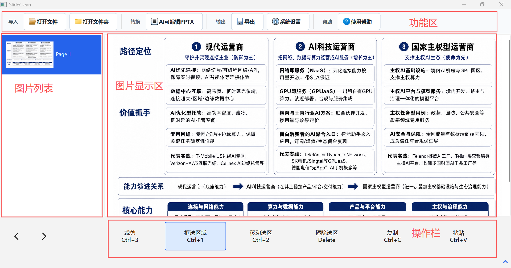

# VisClean

[中文](README.zh-CN.md)

VisClean is a Windows desktop tool that opens PowerPoint, PDF, and image files, renders slides to images, lets you box-select areas to erase, repairs the background with OpenCV inpainting, and exports the result. It can also rebuild images into layered, editable PPTX via AI. It is designed for fine-grained watermark removal and slide cleanup, e.g. removing extra content from PPTX/images generated by AI tools such as NotebookLM, Doubao, and Qwen.

> Formerly `pptx-fig-erase`; renamed to VisClean as the feature set grew.

## Download & Install (Recommended)

No Python environment required — download the packaged executable:

1. Go to the [Releases page](https://github.com/FairmeHIT/VisClean/releases)
2. Download the latest `SlideClean_Windows_x64_vX.Y.Z.zip`
3. Unzip and run `SlideClean.exe`

Note: even with the packaged build, Microsoft PowerPoint must be installed on the machine (PPTX-to-image conversion relies on PowerPoint COM automation).

## Screenshots



More screenshots in the [screenshots/](screenshots/) directory (being added).

## Features

- PySide6-based Windows desktop UI
- Opens `.pptx` and `.pdf` files; PDF pages are rendered to images before editing
- Opens PNG, JPG/JPEG/JFIF, GIF, WEBP, BMP, TIF/TIFF images
- Exports slides to PNG via Microsoft PowerPoint COM automation
- Rectangular region selection on slide images
- Erases selection content with OpenCV inpainting
- Basic undo and redo
- PPTX/PDF sources export to image-based PPTX, PPT, or per-page PNG images
- Image export saves all pages into an `images/` folder under the chosen directory
- Converts a folder of images (in filename order) directly into an image-based PPTX
- Converts a folder of images into a layered editable PPTX: background, frame, icons/decoration extracted and generated by the Evolink image model, text boxes written as real PPT text via a sidecar JSON

## Requirements

- Windows 10 or Windows 11
- Python 3.10 or newer
- Microsoft PowerPoint installed
- PowerPoint COM automation working

Note: WPS or other presentation suites cannot replace Microsoft PowerPoint. PPTX-to-image conversion depends on PowerPoint COM.

## First-Time Setup

Run in the project root:

```powershell
python -m venv .venv
.\.venv\Scripts\python.exe -m pip install --upgrade pip
.\.venv\Scripts\python.exe -m pip install -r requirements.txt
```

## Launching the App

Use `pythonw.exe` to launch the desktop window without an extra console:

```powershell
.\.venv\Scripts\pythonw.exe -m app.main
```

For development, use the debug launch:

```powershell
.\.venv\Scripts\python.exe -m app.main
```

## Usage

1. Launch the program.
2. To adjust PPTX/PDF render quality, change `PPT/PDF screenshot width` in the top `Settings`. This only affects PPTX/PDF imports; directly imported images are never rescaled.
3. Click `Open` at the top and pick a PPTX/PDF file, or one or more image files; click `Open Folder` to load all images from a folder in filename order.
4. For PPTX/PDF, wait while slides/PDF pages are converted to images; images and image folders go straight to editing.
5. Select a page in the left thumbnail panel.
6. To erase content, click `Erase Tool` at the top to show the bottom editing toolbar.
7. Click `Box Select` at the bottom and drag on the page to select a region to erase; hold `Shift` to select multiple regions, left-click to clear all selections.
8. Click `Copy` (`Ctrl+C`) to copy the selection; click `Paste` (`Ctrl+V`) to paste it at a 24px offset or aligned to the current selection.
9. Click `Insert Text`, type the text, then click anywhere on the image to insert it.
10. Click `Move Selection` and drag inside the box to move the content to a new position (the original spot is automatically repaired); or nudge with the arrow keys (hold `Shift` to move 50px per step, otherwise 10px).
11. Click `Erase Selection` to perform the erase.
12. Use `Undo` at the bottom to go back.
13. Press `Ctrl+S` to save edits: a directly opened image is overwritten in place (original format preserved); multi-page documents are saved to the `images/` folder of the chosen directory.
14. Click `Export` at the top to save the processed file according to the source type.

Hold the right mouse button and drag on the canvas to pan the image.

Images to image-based PPTX: open images via `Open File` or `Open Folder`, click `Export`, choose `PPTX` to merge all pages into an image-based PPTX in order.

Image folder to editable PPTX:

1. Click `Settings` at the top, fill in and save the `Evolink Key` in the `AI Editable PPTX` group. Alternatively keep using `.key/.env_evolink_api_key` or the `EVOLINK_API_KEY` environment variable.
2. In the same group choose the `Conversion engine`: `Gorden 4-layer rebuild` is the built-in flow; `Image-to-Editable-PPT CLI` is an experimental adapter for later integration of the full `editppt` workflow.
   - The `Image-to-Editable-PPT CLI` engine needs the `image-to-editable-ppt` skill: install its `editppt` CLI globally, or place the skill source at `skills/image-to-editable-ppt-skill-main/` in the repo root (large, not included in the repository).
3. Click `Open File` to open a PPTX/PDF/image first, then click `AI Editable PPTX`. The app prefers the currently open pages and writes `{original name}_editable.pptx` next to the source file.
4. If no file is open, clicking `AI Editable PPTX` prompts for a folder of images and writes `{folder name}_editable.pptx` inside it; a numeric suffix is appended if a file with the same name exists.
5. Choose the background mode: `generated` calls Evolink to generate a clean background; `blank` skips background generation and uses a transparent background.
6. A progress window shows the page and layer currently being processed.
7. Each conversion gets an isolated `image2pptx_runs/...` run directory holding source images, prompts, generated layers, the manifest and the layout.
8. `Gorden 4-layer rebuild` calls a vision text model to extract ordinary text and write it as editable text boxes; if `editable_texts.json` exists in the image folder or next to the source file, its manual text-box data takes priority.

Single-page `editable_texts.json` example:

```json
{
  "texts": [
    {
      "text": "Editable title",
      "source_bbox": [120, 80, 600, 64],
      "size_px": 48,
      "color": "#111827",
      "bold": true,
      "align": "left"
    }
  ]
}
```

For multiple pages use a `pages` array, in the same order as the natural sort of the images in the folder:

```json
{
  "pages": [
    {"texts": [{"text": "First page title", "source_bbox": [120, 80, 600, 64], "size_px": 48}]},
    {"texts": [{"text": "Second page title", "source_bbox": [120, 80, 600, 64], "size_px": 48}]}
  ]
}
```

Export rules:

- Opening PPTX/PDF allows exporting to image-based PPTX, PPT, or per-page PNG images.
- Choosing image export creates an `images/` folder in the chosen directory and saves each page as PNG.
- A single opened image exports as one PNG file.
- Multiple opened images export either merged into an image-based PPTX or as per-page PNGs in the chosen directory.

## Project Structure

```text
app/
  core/       conversion, erase, export, session and history logic
  ui/         PySide6 desktop UI
  utils/      PowerPoint, path and image helpers
  workers/    background conversion and erase tasks
tests/        unit tests
screenshots/  promotional screenshots
tools/        auxiliary verification scripts
```

## Running Tests

```powershell
.\.venv\Scripts\python.exe -m pytest
```

## Publishing a New Release

1. Make sure all tests pass and the features work.
2. Tag and push:

```powershell
git tag v0.2.0
git push origin v0.2.0
```

3. GitHub Actions will automatically run the tests, package `SlideClean.exe` with PyInstaller, zip it as `SlideClean_Windows_x64_vX.Y.Z.zip`, and create a Release.
4. Go to the repo's Releases page to confirm the published artifacts; you can add release notes if needed.
