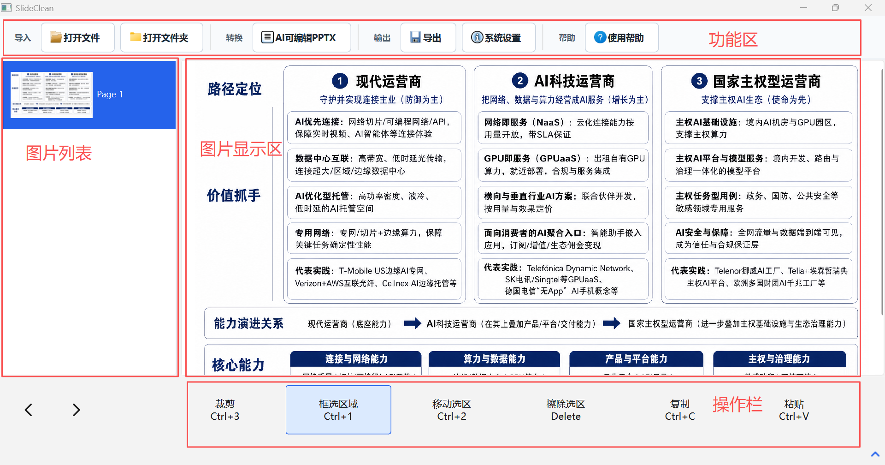

<div align="center">

# VisClean (幻灯片清痕)

**清理幻灯片与图片，用 AI 重建为可编辑 PPTX —— OpenCV 修复 + AI 生图。**

[English](README.md)

[](https://github.com/FairmeHIT/VisClean/releases)
[](https://github.com/FairmeHIT/VisClean/releases)
[](LICENSE)
[](#环境要求)
[](#环境要求)

**[下载安装](https://github.com/FairmeHIT/VisClean/releases) · [功能特性](#功能特性) · [AI 可编辑 PPTX](#ai-可编辑-pptx) · [使用流程](#使用流程) · [开发](#开发)**

</div>

VisClean 是一个 Windows 桌面工具，用于打开 PowerPoint / PDF / 图片文件，将幻灯片转换为图片，在页面上框选需要擦除的区域，使用 OpenCV 修复背景，并导出处理后的结果；还支持通过 AI 将图片重建为分层可编辑 PPTX。

适用于精细化图片水印去除与幻灯片清理，比如从 NotebookLM、豆包、Qwen 等 AI 大模型生成的 pptx/图片中去除多余的内容。

> 原名 `pptx-fig-erase`，随功能扩展更名为 VisClean。

<p align="center">
  
</p>

## 下载安装

无需安装 Python 环境，直接下载打包好的可执行文件：

1. 进入 [Releases 页面](https://github.com/FairmeHIT/VisClean/releases)
2. 下载最新版的 `SlideClean_Windows_x64_vX.Y.Z.zip`
3. 解压后运行 `SlideClean.exe`

注意：即使使用打包版本，本机仍需安装 Microsoft PowerPoint（PPTX 转图片功能依赖 PowerPoint COM 自动化）。

## 功能特性

| 能力 | 说明 |
| --- | --- |
| **打开与转换** | 打开 `.pptx` 和 `.pdf` 文件（PDF 按页截图后进入编辑）；打开 PNG、JPG/JPEG/JFIF、GIF、WEBP、BMP、TIF/TIFF 图片；通过 PowerPoint COM 自动化将幻灯片导出为 PNG |
| **擦除与编辑** | 矩形框选、OpenCV inpainting 擦除、选区复制/粘贴、移动选区并自动修复原位、插入文本、基础撤销/重做 |
| **导出** | PPTX/PDF 来源可导出为图片版 PPTX、PPT 或逐页 PNG；图片导出保存到所选目录的 `images/` 文件夹 |
| **图片文件夹转 PPTX** | 按文件名顺序将图片文件夹直接转换为图片版 PPTX |
| **AI 可编辑 PPTX** | 将图片重建为分层可编辑 PPTX：背景、框架、图标/装饰由 Evolink 生图模型生成，文本框通过 sidecar JSON 写入为真正 PPT 文本 |

## AI 可编辑 PPTX

核心亮点：把一组幻灯片图片重建为**分层可编辑的 PowerPoint 文件**——背景、框架、图标/装饰为生成图片，文字为真正可编辑的文本框。

1. 点击顶部 `系统设置`，在 `AI 可编辑 PPTX` 分组中填写并保存 `Evolink Key`。也可以继续使用 `.key/.env_evolink_api_key` 或环境变量 `EVOLINK_API_KEY`。
2. 在同一分组中选择 `转换引擎`：`Gorden 四层重建` 是当前内置流程；`Image-to-Editable-PPT CLI` 是实验适配器，用于后续接入完整 `editppt` 工作流。
   - `Image-to-Editable-PPT CLI` 引擎需要 `image-to-editable-ppt` 技能：全局安装其 `editppt` CLI，或将技能源码放在仓库根目录 `skills/image-to-editable-ppt-skill-main/`（体积较大，未纳入仓库）。
3. 先点击顶部 `打开文件` 打开 PPTX/PDF/图片，再点击顶部 `AI可编辑PPTX`。程序会优先使用当前已打开的页面，并在原文件所在目录生成 `{原文件名}_editable.pptx`。
4. 如果尚未打开文件，点击 `AI可编辑PPTX` 时会选择包含图片的文件夹，并在该文件夹中生成 `{文件夹名}_editable.pptx`；如果同名文件已存在，会自动追加序号。
5. 选择背景模式：`generated` 会调用 Evolink 生成干净背景；`blank` 会跳过背景生图并使用透明背景。
6. 生成期间会显示进度窗口，提示当前正在处理的页和图层。
7. 程序会为每次转换创建独立的 `image2pptx_runs/...` 运行目录，保存源图、提示词、生成层、manifest 和 layout。
8. `Gorden 四层重建` 会调用视觉文本模型提取普通文字并写成可编辑文本框；如果图片文件夹或原文件目录中存在 `editable_texts.json`，则优先使用其中的人工文本框数据。

单页 `editable_texts.json` 示例：

```json
{
  "texts": [
    {
      "text": "Editable title",
      "source_bbox": [120, 80, 600, 64],
      "size_px": 48,
      "color": "#111827",
      "bold": true,
      "align": "left"
    }
  ]
}
```

多页时可以使用 `pages` 数组，顺序与文件夹中的图片自然排序一致：

```json
{
  "pages": [
    {"texts": [{"text": "第一页标题", "source_bbox": [120, 80, 600, 64], "size_px": 48}]},
    {"texts": [{"text": "第二页标题", "source_bbox": [120, 80, 600, 64], "size_px": 48}]}
  ]
}
```

导出规则：

- 打开 PPTX/PDF 时，可导出为图片版 PPTX、PPT，或导出为逐页 PNG 图片。
- 选择图片导出时，会在所选目录下创建 `images/` 文件夹，并逐页保存为 PNG 图片。
- 打开单张图片时，导出为一个 PNG 文件。
- 打开多张图片时，导出可选择合并为图片版 PPTX，或保存为逐页 PNG 图片到所选目录。

## 使用流程

1. 启动程序。
2. 如需调整 PPTX/PDF 转图片的清晰度，在顶部 `系统设置` 中修改 `PPT/PDF 截图宽度`。该设置只影响 PPTX/PDF 导入，不会缩放直接导入的图片。
3. 点击顶部 `打开`，选择需要处理的 PPTX/PDF 文件，或选择一张/多张图片文件；点击顶部 `打开文件夹`，选择包含图片的文件夹，程序会按文件名顺序加载其中的所有图片。
4. 如果打开的是 PPTX/PDF，等待程序将幻灯片或 PDF 页面转换为图片；如果打开的是图片或图片文件夹，会直接进入编辑。
5. 在左侧缩略图中选择页面。
6. 需要擦除内容时，点击顶部 `擦除工具` 调出底部编辑工具栏。
7. 点击底部 `框选区域`，在页面上拖拽框选需要擦除的区域；按住 `Shift` 可框选多个区域，左键点击可取消所有选区。
8. 点击底部 `复制`（快捷键 `Ctrl+C`）复制选区内容，点击 `粘贴`（快捷键 `Ctrl+V`）粘贴到偏移 24px 位置或当前选区对齐位置。
9. 点击底部 `插入文本`，输入文本后点击图片任意位置即可插入。
10. 点击底部 `移动选区`，在选框内按住鼠标拖拽，可将选中内容移动到新位置，原位置自动修复；也可用键盘方向键步进移动（按住 `Shift` 每次移动 50px，否则 10px）。
11. 点击底部 `擦除选区` 执行擦除。
12. 需要回退时使用底部 `撤销`。
13. 按下快捷键 `Ctrl+S` 保存编辑结果：直接打开图片时会在原图上原位覆盖保存（保留原格式）；多页时保存到所选文件夹的 `images/` 目录。
14. 点击顶部 `导出`，按来源类型保存处理后的文件。

在图片展示区域按住鼠标右键拖动，可以移动图片查看不同区域。

图片转图片版 PPTX：点击顶部 `打开文件` 或 `打开文件夹` 导入图片后，点击 `导出`，选择 `PPTX` 即可将全部页面按顺序合并为图片版 PPTX。

## 环境要求

- Windows 10 或 Windows 11
- Python 3.10 或更高版本（仅源码运行需要）
- 本机已安装 Microsoft PowerPoint（打包版本同样需要）
- PowerPoint COM 自动化可正常使用

注意：WPS 或其他演示软件不能替代 Microsoft PowerPoint。本工具的 PPTX 转图片功能依赖 PowerPoint COM。

## 开发

在项目根目录执行：

```powershell
python -m venv .venv
.\.venv\Scripts\python.exe -m pip install --upgrade pip
.\.venv\Scripts\python.exe -m pip install -r requirements.txt
```

推荐使用 `pythonw.exe` 启动桌面窗口，不会额外打开控制台：

```powershell
.\.venv\Scripts\pythonw.exe -m app.main
```

开发时可以使用调试启动方式：

```powershell
.\.venv\Scripts\python.exe -m app.main
```

运行测试：

```powershell
.\.venv\Scripts\python.exe -m pytest
```

```text
app/
  core/       转换、擦除、导出、会话和历史逻辑
  ui/         PySide6 桌面界面
  utils/      PowerPoint、路径、图片工具
  workers/    后台转换与擦除任务
tests/        单元测试
screenshots/  宣传截图
tools/        辅助验证脚本
```

## 发布新版本

1. 确认所有测试通过、功能可用。
2. 打 tag 并推送：

```powershell
git tag v0.2.0
git push origin v0.2.0
```

3. GitHub Actions 会自动运行测试、用 PyInstaller 打包 `SlideClean.exe`、压缩为 `SlideClean_Windows_x64_vX.Y.Z.zip` 并创建 Release。
4. 前往仓库的 Releases 页面确认发布内容，可按需补充更新说明。

## 开源协议

[MIT](LICENSE)
